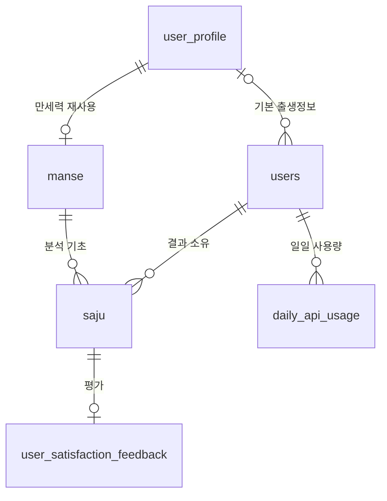

# 데이터 모델: 빈 분석 구조에서 시작

**수정일**: 2026-10-31 | **기준**: [spec.md](spec.md), [research.md](research.md)

## 1. 초기화 범위

`user_profile`, `daily_api_usage`, `user_satisfaction_feedback`, `saju_result`, `saju_full_data`, `career_fortune`, `user_saju_access`, `career_consultation`, `company_compatibility`의 모든 행을 초기화한다. `users`와 인증 관련 데이터는 유지한다. 새 프로필·만세력·분석·피드백은 빈 상태에서 시작한다. 사용량 초기화로 당일 소모 쿼터도 재설정된다.

초기화 전에 피드백 원본 전체와 [명세의 건수 기준](spec.md)에 따른 집계를 로컬로 제공하고 DB 대조 및 운영자 확인을 마쳐야 한다. 이 문서는 실제 SQL을 포함하지 않으며 이번 작업에서 데이터를 변경하지 않는다.

구형 전용 테이블 `user_saju_access`, `career_consultation`, `career_fortune`, `saju_full_data`, `company_compatibility`, `saju_result`는 원본 제공·대조·운영자 확인·행 초기화가 끝난 뒤 새 스키마 단계에서 DROP한다. 빈 `user_profile`과 `daily_api_usage`는 재사용한다. 피드백 테이블은 재사용하되 구형 두 대상 FK와 컬럼 및 feedback_type을 제거하고 새 saju_id·유일 제약과 작성자 NOT NULL을 적용한다. 구체적인 DDL은 제외된 로컬 실행 문서의 f절에 둔다.

## 2. 관계

사용자는 기본 프로필을 0개 또는 1개 참조하고 하나의 공유 프로필을 여러 사용자가 기본값으로 선택할 수 있다. `users.user_profile_id`는 기본값, 실제 분석 출생정보는 `saju → manse → user_profile`로 조회하고, `saju.user_id`는 결과 소유자를 뜻한다.

프로필만 생성된 뒤 분석이 실패할 수 있어 프로필의 만세력은 아직 없을 수 있다. 성공한 `saju`는 모든 유형에서 만세력을 필수 참조하고 실제 분석 프로필은 만세력을 경유한다. 결과에는 직접 소유자가 한 명 있고, 공유 프로필은 결과 접근 권한을 부여하지 않는다.

## 3. 프로필 — user_profile

| 필드 | 형식 | 제약 |
|---|---|---|
| id | BIGINT | PK |
| birth_date | DATE | NOT NULL |
| birth_time | TIME | NOT NULL |
| created_at / updated_at | Instant | 기존 감사 시각 관례 |

생년월일·시각 조합 유일 제약을 유지한다. 기존 행은 모두 삭제하며 기본 출생정보 저장 또는 신규 분석 요청에서 처음 생성한다. 관운·컨설팅 시각 필수, 궁합의 시각 누락 정규화 등 기존 검증 의미는 유지한다. 소유자 필드는 추가하지 않는다.

공유 프로필의 출생정보는 생성 후 변경하지 않는다. 기본 출생정보 변경은 해당 출생정보의 프로필을 조회·생성하고 사용자 FK만 교체한다. 기본 프로필을 바꾸거나 다른 출생정보로 분석해도 기존 `saju.manse_id`·만세력의 프로필 참조와 입력·결과 스냅샷은 변경하지 않는다. 기본 프로필 저장만으로 만세력·분석을 생성하거나 쿼터를 차감하지 않는다.

## 4. 만세력 — manse

| 필드 | 형식 | 제약 |
|---|---|---|
| id | BIGINT | PK |
| user_profile_id | BIGINT | NOT NULL FK user_profile, UNIQUE |
| data_json | JSON | NOT NULL, ManseData record로 다루는 만세력 전체 계산 데이터 |
| fetched_at | Instant | NOT NULL, 신규 요청의 FastAPI 취득 시각 |
| created_at | Instant | 만세력 최초 저장 시각 |

신규 요청에서 프로필의 만세력이 없으면 FastAPI 결과와 공통 계산을 `data_json` 하나에 담아 한 행을 원자적으로 저장한다. 개별 계산 필드를 조건 검색·집계하지 않고 프로필로 찾아 전체를 읽으므로 별도 계산 컬럼이나 JSON 컬럼으로 나누지 않는다. 테이블 컬럼은 id, user_profile_id, data_json, fetched_at, created_at이다.

`ManseData`는 schemaVersion과 yearPillar/monthPillar/dayPillar/hourPillar, heavenlyStems/earthlyBranches, dayMaster/dayMasterElement, fiveElements, solarCorrection, tenGodHiddenStemAnalysis를 가진 Java record다. 십성·지장간은 기존 TenGodHiddenStemAnalysis를 중첩해 타입과 의미를 유지한다. 각 기둥과 천간·지지 배열은 같은 JSON 안에 모두 저장하며 서로 같다고 가정해 한쪽을 버리지 않는다.

기존 Jackson 3·JSON 변환 지원을 재사용해 ManseData 전체를 직렬화한다. 기존의 개별 필드용 IntegerMapConverter 등을 만세력 컬럼마다 적용하지 않는다. 필수값·배열 길이·허용값은 저장 전과 JSON 읽기 후 기존 검증 기준에 따라 확인한다. 계산기/caller 어댑터는 ManseData의 배열·오행·태양 보정과 프로필의 출생정보를 사용한다. 재사용에도 유형별 검증을 실행한다. 상세 JSON 필드 계약은 [저장 계약](contracts/storage.md)을 따른다.

프로필·만세력 저장에 분산락은 사용하지 않고 DB 유일 제약으로 중복을 막는다. 동시 최초 요청의 외부 호출 중복은 허용한다. 외부 호출은 트랜잭션 밖에서 수행하고, 알려진 유일 제약 경합은 실패한 쓰기 트랜잭션이 종료된 뒤 정본을 조회한다. 다른 무결성 오류는 실패로 전파한다. 만세력에는 요청별 최종 해석·관운 tuple·AI 문구를 두지 않는다.

## 5. 분석 — saju

| 필드 | 형식 | 제약 |
|---|---|---|
| id | BIGINT, Java Long | PK, AUTO_INCREMENT. API는 JSON 숫자 |
| user_id | BIGINT | NOT NULL FK users, 직접 소유자 |
| analysis_type | VARCHAR(32) | NOT NULL, 기존 세 AnalysisType 값 |
| manse_id | BIGINT | NOT NULL FK manse, 모든 유형 필수 |
| created_at | Instant | NOT NULL, 이 성공 결과의 생성 시각 |
| input_json | JSON | NOT NULL, 유형별 요청·실제 계산 입력 |
| result_json | JSON | NOT NULL, 검증된 최종 결과 스냅샷 |

`saju`의 시각 컬럼은 `created_at` 하나다. 목록·상세·기간 필터·정렬·관리자 집계 모두 같은 컬럼을 기준으로 한다. 분석 ID는 BIGINT AUTO_INCREMENT·Java Long이며 기존 응답의 ID 필드명과 JSON 숫자 형식을 유지한다. 새 테이블에서 처음부터 발급하며 과거 최댓값 조회·시작 번호 보정·ID 저장소·호환 매핑은 만들지 않는다. 과거 번호와 겹칠 수 있으며 예전 URL의 영구 404는 보장하지 않는다. 모든 조회·피드백에서 현재 결과 소유권과 유형 검증은 유지한다.

ID·enum·새 감사 시각의 물리 형식은 [저장 계약](contracts/storage.md)의 BIGINT·VARCHAR(32)·DATETIME(6)/UTC 매핑을 따른다. 상세 DDL은 제외된 로컬 실행 문서 f절에만 둔다.

인덱스:

- `(user_id, created_at DESC, id DESC)`: 개인 목록.
- `(user_id, analysis_type, created_at DESC, id DESC)`: 개인 유형 필터.
- `(created_at DESC, id DESC)`와 `(analysis_type, created_at DESC, id DESC)`: 관리자 목록·기간·유형 집계.

입력·월·회사·직무·모델 기반 결과 유일 제약은 없다. 성공 요청마다 INSERT 한 건이며 기존 결과 갱신·병합 메서드를 두지 않는다. completed·진행 상태·실패 결과·결제 키·재전송 중복 방지 필드는 없다.

분석에 실제 사용한 만세력을 참조하고 프로필은 해당 만세력의 user_profile_id로만 연결한다. 중복 프로필 FK와 두 FK 간 일치 검증은 두지 않는다. 만세력의 프로필 참조는 생성 후 바꾸지 않는다. 소유자는 인증 주체에서 주입한다. 주입된 Clock/JPA auditing으로 시각을 정하고 외부 호출 완료 후 별도 쓰기 서비스에서 저장·커밋한다.

관리자 분석 목록·count·상세·통계는 기존 JdbcTemplate SQL로 saju.user_id와 스냅샷을 읽어 DTO에 직접 매핑한다. User 엔티티 조인·지연 로딩은 사용하지 않아 @SQLRestriction("deleted_at IS NULL")으로 탈퇴 사용자의 분석이 누락되지 않게 한다. 계정 표시가 필요할 때만 SQL로 users를 조인해 대체된 이름/이메일을 읽는다. 이를 위해 같은 user_id를 엔티티에 중복 매핑하지 않는다.

## 6. 피드백 — user_satisfaction_feedback

| 필드 | 형식 | 제약 |
|---|---|---|
| id | BIGINT | PK |
| user_id | BIGINT | NOT NULL FK users, 인증된 작성자이며 saju.user_id와 같음 |
| saju_id | BIGINT | NOT NULL FK saju, UNIQUE |
| satisfaction_status | VARCHAR(32), 기존 enum | SATISFIED/DISSATISFIED, NOT NULL, 기존 검증 유지 |
| feedback_content | VARCHAR(500) | 기존 검증 유지 |
| created_at | Instant | 기존 감사 시각 관례 |

기존 모든 행을 원본 제공·대조·운영자 확인 후 삭제한다. 새 피드백의 대상 FK는 `saju_id` 하나뿐이다. 구형 컨설팅·궁합별 FK 컬럼은 새 스키마에 남기지 않는다. 작성자는 결과 소유자와 같아야 한다. 피드백에 분석 유형을 중복 저장하지 않고 연결된 `saju.analysis_type`으로 컨설팅·궁합만 허용하며 관운 대상은 HTTP 404로 거부한다. 관리자 유형 표시·필터도 연결된 분석의 유형을 사용한다. 분석당 피드백은 0개 또는 1개다. saju_id 유일 제약으로 동시 중복 생성도 막으며 같은 분석의 재제출은 409로 거부한다.

런타임 회원 탈퇴는 기존 계정 soft delete와 피드백 hard delete를 유지한다. saju 행·user_id·manse_id·스냅샷과 공유 프로필·만세력은 유지하고 users.user_profile_id만 NULL로 해제한다. User.softDelete의 이름 대체·이메일 대체·INACTIVE·deleted_at 처리를 유지하며 원래 이름·이메일을 별도로 분석 JSON에 복사하지 않는다. 관리자도 사용자 표시는 탈퇴 계정의 대체 값으로 제공하고 saju 집계·기존 관리자 권한의 상세 조회에는 탈퇴 사용자 분석을 포함한다. 일반 사용자에게 탈퇴 계정의 결과를 공개하지 않는다.

출생정보·결과 스냅샷과 내부 user_id 연결은 남으므로 완전한 익명화나 분석 데이터 삭제를 뜻하지 않는다. 기본 참조 해제만으로 분석의 출생정보가 제거된다고 설명하지 않는다. 공유 프로필·만세력을 탈퇴에 연쇄 삭제하지 않는다. daily_api_usage는 기존 탈퇴 동작을 유지하며 추가 삭제하지 않는다.

관리자 회원 목록·상세도 기존 JdbcTemplate SQL로 users를 직접 읽고 saju.user_id별 집계를 LEFT JOIN해 0건·탈퇴 회원을 포함한다. 기존 명시적 회원 필터는 유지하며 일반 사용자용 User의 @SQLRestriction은 제거하지 않는다. 탈퇴 전후 분석 목록·count·상세·통계와 대체 계정 표시를 실제 DB 회귀로 확인한다.

피드백 삭제·기본 참조 해제·계정 soft delete는 한 트랜잭션에서 처리한다. 탈퇴와 분석 결과/피드백/기본값 저장은 사용자 행의 짧은 쓰기 잠금·활성 상태 확인으로 순서를 정해 탈퇴 완료 뒤 새 쓰기가 생기지 않게 한다. 외부 호출 중에는 잠금을 잡지 않는다. 탈퇴 전에 커밋한 분석은 남고, 탈퇴가 먼저 완료된 분석 요청의 최종 저장은 거부하며 커밋 전 쿼터 보상을 따른다. 인증 세션 무효화는 기존 경로를 유지한다.

전환 전 원본 내보내기에는 soft delete 필터를 적용하지 않는다. 실제로 탈퇴 사용자 피드백이 0건이어도 정상이며 이미 삭제된 행을 복원하지 않는다.

## 7. 계정·인증·일일 사용량

`users`에 다음 기본 출생정보 참조를 추가한다. 계정·인증 필드는 유지한다.

| 필드 | 형식 | 제약 |
|---|---|---|
| user_profile_id | BIGINT | NULL 허용 FK user_profile, UNIQUE 아님, 삭제 연쇄 전파 없음 |

가입 직후와 초기화 후에는 NULL이며 직접 입력을 안내한다. 기본 프로필은 사용자의 명시적인 저장·변경으로만 설정하고 분석 성공 시 자동 교체하지 않는다. 다른 출생정보로 분석해도 소유자는 인증 사용자다. 기본값은 출생정보 입력을 제안하는 용도이며 분석 권한의 근거가 아니다.

구형 스키마에서 초기화를 마친 뒤 새 스키마 단계에서 이 nullable FK를 추가한다. 유지된 계정의 기본 참조는 모두 NULL로 시작하며 과거 분석에서 기본값을 추정하지 않는다.

사용자와 인증 관련 테이블·Redis 인증 상태는 초기화 대상이 아니다. 분석 초기화 과정에서 계정 FK의 연쇄 삭제나 인증 정보 손실이 발생하지 않도록 확인한다.

`daily_api_usage`는 모든 행을 비운다. 전환 후 기존 사용자별 날짜 유일 키·원자적 공유 3회 차감·원래 날짜 보상을 그대로 사용한다. 초기화 직후 당일 기존 소비도 0에서 다시 시작한다.

## 8. 전환 전 제공 자료

원본 내보내기는 기존 피드백 테이블의 모든 컬럼·모든 행을 그대로 제공한다. 새 피드백 스키마에 맞추지 않고 예전 FK 컬럼도 있는 그대로 포함한다. 탈퇴 사용자·미연결 행도 제외하지 않는다. 원본 자료와 건수 보고서는 모두 로컬에만 보관하며 새 구조에 다시 넣지 않는다.

건수 보고서는 유형별 원본 수, SAJU 접근 수, 사용자별 유형 수와 각 원본 테이블/연결 기준을 적는다. 상세 정의와 대조 기준은 [spec.md](spec.md)와 [quickstart.md](quickstart.md)를 따른다. 보고서 양식과 실제 내보내기·조회·대조·삭제 SQL은 Git에서 제외된 로컬 문서(`specs/007-unify-saju-analysis/local/reset-runbook.md`)로 제공하며 저장소에는 포함하지 않는다. 이 설계 문서에는 항목 정의만 유지한다.

## 9. 수명 주기와 영향

빈 구조에서 검증→해당 유형 쿼터 차감→프로필/만세력 확보→요청별 분석·검증→성공 결과 저장 순으로 처리한다. 커밋 전 실패는 분석 행을 남기지 않으며 유효한 기초 정보는 남을 수 있다. 커밋 후 결과는 조회로 바뀌지 않는다.

초기화 전 마이페이지 이력·피드백·관리자 과거 상세·기둥 문자열은 사라진다. 과거 ID 호환이나 예전 URL의 영구 404는 보장하지 않으며 새 테이블의 숫자 ID로만 조회한다. 관리자 통계는 새 `saju`만 집계한다.
