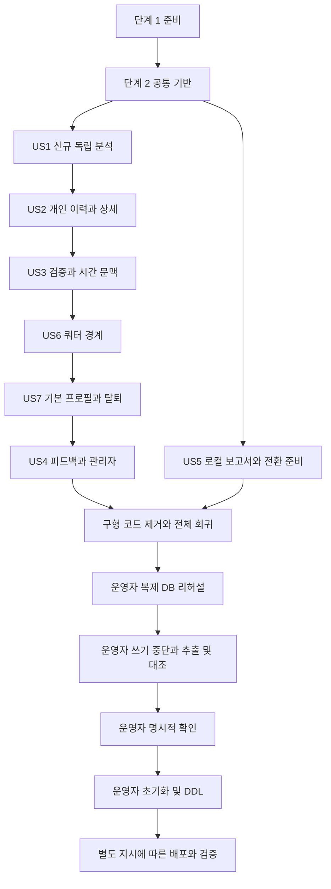

# 작업 목록: 분석 결과 통합 및 기존 분석 전체 초기화

**기능**: `007-unify-saju-analysis` | **작성일**: 2026-10-29

**입력 문서**: [명세](spec.md), [구현 계획](plan.md), [설계 결정](research.md), [데이터 모델](data-model.md), [API 계약](contracts/api.md), [저장 계약](contracts/storage.md), [전환 절차](quickstart.md).

**상태**: 작업 생성만 완료했다. 아래 항목은 모두 미완료이며 애플리케이션 코드·DB·SQL 실행·배포·커밋은 수행하지 않았다.

**테스트**: 명세 FR-015와 SC-001~014가 런타임 검증을 명시하므로 테스트 작업을 포함한다. 각 시나리오의 테스트를 먼저 작성해 기존 동작에서 실패함을 확인하고 구현 후 통과시킨다. 운영 초기화/DDL SQL용 runner·이관 통합 테스트는 만들지 않는다.

**표기**: `- [ ] T번호 [P] [US번호] 설명과 경로`. `[P]`는 명시한 선행 작업 완료 후 서로 다른 파일에서 병렬 수행 가능한 작업이다. 같은 파일을 만지는 시나리오는 아래 의존 관계에 따라 순차 진행한다. 모든 경로는 저장소 루트 기준이며 새 파일은 상위 패키지를 생성한다.

**확정 경계**:

- 추출 시작부터 새 스키마 DDL 적용·validate 통과·호환 애플리케이션 배포 완료까지 관련 쓰기 경로의 트래픽 차단 또는 애플리케이션 중지를 필수로 유지하고 진행 중 쓰기를 모두 종료한다. 분석·피드백·프로필·사용량·회원 탈퇴 등 관련 쓰기 전체의 중단을 보장할 수 없으면 초기화를 중단한다. 차단 방법은 운영자가 선택하며 별도 차단 기능 개발은 범위에 포함하지 않는다. 차단이 해제되거나 쓰기가 발생하면 즉시 중단하고, 차단을 복구한 뒤 자료 재추출·대조와 운영자 재확인을 거쳐야 한다.

- 실제 분석 프로필은 `saju → manse → user_profile`로 조회한다. saju에 중복 프로필 FK를 두지 않으며 users의 기본 참조와 결과의 직접 소유자를 구분한다.
- 과거 분석은 새 구조로 이동하지 않는다. 전환 시 기존 분석을 비우고 구형 전용 테이블을 제거한다. 전환 후 회원 탈퇴 시에는 새 분석을 유지한다.
- 탈퇴는 계정 soft delete·기존 이름/이메일 대체·피드백 삭제·기본 참조 NULL이다. 출생정보와 분석 스냅샷이 남으므로 완전한 익명화로 표현하지 않는다.
- 관리자 응답의 유형 필드/통계 필드명은 유지하고 값은 연결된 saju에서 얻는다. 제거 대상은 피드백 작성 요청의 feedbackType과 DB feedback_type이다.
- 보고서·실제 SQL·개인정보 결과는 Git에서 제외된 `specs/007-unify-saju-analysis/local/`에만 둔다. 커밋되는 작업 목록에는 SQL을 넣지 않는다. 로컬 문서가 없으면 spec.md·quickstart.md의 정의로 운영자가 다시 준비한다.
- 운영자 전용 작업은 운영 계획이다. `/speckit-implement` 등 자동 구현 요청은 운영 DB 접속·초기화·DDL·배포의 승인이 아니며 자동으로 실행하거나 완료 표시하지 않는다. 별도 지시·실제 증거가 없으면 미완료로 남기고 인계한다.
- 구현·검증 중에도 사용자가 별도 지시하기 전 커밋·스테이징하지 않는다. 운영 시점의 명시적 확인은 문서 작성/작업 생성과 별개다.

## 단계 1: 준비

**목표**: 기존 단일 모듈과 테스트 도구를 재사용하고 설계의 검증 자료를 준비한다. 새 의존성·운영 DB 접속을 추가하지 않는다.

**독립 검증**: Java 21·Gradle·Docker 사용 조건과 기존 테스트 기준을 기록하고 합성 자료로만 테스트를 준비한다.

- [ ] T001 `SSAju/build.gradle`, `SSAju/gradle/wrapper/gradle-wrapper.properties`와 `specs/007-unify-saju-analysis/quickstart.md`를 기준으로 Java 21·기존 MySQL/Redis Testcontainers·외부 API stub·테스트 명령을 확인하고 구현 시작 시 기존 테스트 결과를 `specs/007-unify-saju-analysis/local/implementation-checks.md`에 기록한다. 실제 운영 DB나 외부 분석 API는 호출하지 않는다.
- [ ] T002 [P] 세 유형의 ID 없는 완성 스냅샷과 만세력·고정 시각에 대한 합성 자료를 `SSAju/src/test/resources/analysis/manse-data.json`, `SSAju/src/test/resources/analysis/saju-result.json`, `SSAju/src/test/resources/analysis/consultation-result.json`, `SSAju/src/test/resources/analysis/compatibility-result.json`에 작성한다. 실제 개인정보와 과거 DB 원본을 넣지 않는다.
- [ ] T003 [P] 기존 `SSAju/src/test/java/ssafy/SSAju/integration/CareerResultJsonStorageIntegrationTest.java`와 `SSAju/src/test/java/ssafy/SSAju/concurrency/RedisTestSupport.java`의 패턴으로 `SSAju/src/test/java/ssafy/SSAju/integration/UnifiedAnalysisTestSupport.java`를 준비한다. 외부 API 격리·고정 Clock·합성 사용자/공유 프로필·MySQL/Redis 설정을 재사용하고 테스트 전용 DB만 사용한다. Redis 초기화는 StringRedisTemplate 또는 RedisConnectionFactory를 통한 Spring Data Redis 방식으로 작성하며 RedissonClient 초기화 패턴을 복사하지 않는다.

**완료 기준**: 위 독립 검증의 실제 결과를 확인한 뒤 관련 체크박스를 표시한다. 문서 존재만으로 구현·운영 검증을 완료 처리하지 않는다.

## 단계 2: 공통 기반

**목표**: 신규 저장 구조·typed JSON·시간 문맥·사용자 쓰기 경계를 마련한다. 이후 모든 시나리오는 이 기반에 의존한다.

**독립 검증**: 새 저장 모델의 숫자 ID·JSON·필수 FK·유일 제약을 테스트 DB에서 검증한다. 운영 초기화나 DDL은 실행하지 않는다.

- [ ] T004 [P] `SSAju/src/main/java/ssafy/SSAju/career/domain/AnalysisTimeContext.java`에 요청당 한 번 확정하는 analysisDate/year/month/targetMonths 불변 record를 추가한다. 쿼터 usageDate는 이 문맥으로 대체하지 않는다.
- [ ] T005 [P] `SSAju/src/main/java/ssafy/SSAju/career/domain/ManseData.java`와 `SSAju/src/main/java/ssafy/SSAju/career/converter/ManseDataConverter.java`에 schemaVersion=1·기둥·천간/지지 각 4개·일간/오행·선택 태양 보정·기존 TenGodHiddenStemAnalysis를 하나의 typed JSON으로 구현한다. 기존 `SSAju/src/main/java/ssafy/SSAju/career/converter/CareerJsonObjectMapperSupport.java`를 재사용하며 필수값·길이·허용값 검증을 유지한다.
- [ ] T006 [P] `SSAju/src/main/java/ssafy/SSAju/career/domain/AnalysisPayload.java`와 `SSAju/src/main/java/ssafy/SSAju/career/converter/AnalysisSnapshotCodec.java`에 세 유형별 입력/결과 record와 schemaVersion=1 codec을 추가한다. `specs/007-unify-saju-analysis/contracts/storage.md`의 모든 중첩 필드·요청값/실제 정규화 값·요약을 포함하고 결과 JSON에는 분석 ID를 중복 저장하지 않는다.
- [ ] T007 `SSAju/src/main/java/ssafy/SSAju/career/entity/Manse.java`와 `SSAju/src/main/java/ssafy/SSAju/repository/ManseRepository.java`를 추가한다. 프로필 FK NOT NULL·UNIQUE, data_json 하나, NOT NULL fetched_at/created_at을 두고 프로필 참조는 생성 후 변경하지 않는다. T005에 의존한다.
- [ ] T008 `SSAju/src/main/java/ssafy/SSAju/career/entity/Saju.java`와 `SSAju/src/main/java/ssafy/SSAju/repository/SajuRepository.java`를 추가한다. BIGINT AUTO_INCREMENT·Java Long·직접 소유자·유형·NOT NULL manse_id·created_at·입력/결과 JSON과 네 목록 인덱스를 매핑하고 중복 프로필 FK·history_at·결과 유일 제약·진행 상태를 두지 않는다. BIGINT ID/enum VARCHAR/신규 시각 DATETIME(6)·UTC는 로컬 DDL과 맞춘다. `SSAju/src/main/resources/application.yaml`에 spring.jpa.properties.hibernate.jdbc.time_zone=UTC를 명시하고 신규 Instant는 JDBC TIMESTAMP로 매핑한다. T007·T006에 의존한다.
- [ ] T009 `SSAju/src/main/java/ssafy/SSAju/entity/User.java`에 NULL 허용·non-unique 기본 프로필 FK를 추가하고 `SSAju/src/main/java/ssafy/SSAju/career/entity/UserProfile.java`의 출생정보 불변·출생일시 유일 제약을 유지한다. `SSAju/src/main/java/ssafy/SSAju/repository/UserRepository.java`에 짧은 쓰기 구간의 사용자 행 잠금·활성 상태 확인 경로를 마련한다. 공유 자료에 삭제 연쇄 전파를 두지 않는다.
- [ ] T010 `SSAju/src/main/java/ssafy/SSAju/career/provider/ManseProvider.java`, `SSAju/src/main/java/ssafy/SSAju/service/ManseWriteService.java`, `SSAju/src/main/java/ssafy/SSAju/career/provider/UserProfileProvider.java`에서 프로필/만세력 조회·최초 생성을 구현한다. `SSAju/src/main/java/ssafy/SSAju/service/SajuDataService.java`의 FastAPI 및 공통 계산은 락·트랜잭션 밖에서 수행하고 기초 저장만 짧게 처리한다. 프로필·만세력에는 분산락을 사용하지 않으며 UserProfileProvider의 기존 @DistributedLock을 제거한다. 동시 최초 요청의 외부 호출 중복은 허용한다. 알려진 유일 제약 경합만 실패 트랜잭션 종료 후 정본 재조회로 수렴시키고 다른 오류는 전파한다. T007·T009에 의존한다.
- [ ] T011 `SSAju/src/main/java/ssafy/SSAju/career/strategy/AnalysisStrategy.java`에 type/inputType/validateInput/analyze/validateResult 계약을 추가하며 analyze 인자에 AnalysisTimeContext를 처음부터 포함한다. 기존 세 AnalysisType·요청 DTO·검증을 사용하고 인증·쿼터·저장을 전략에 넣지 않는다. T004·T006·T010에 의존한다.
- [ ] T012 `SSAju/src/test/java/ssafy/SSAju/integration/UnifiedAnalysisStorageIntegrationTest.java`에서 모든 유형 manse 필수·BIGINT 자동 증가 ID·단일 만세력 JSON 전 필드 왕복·잘못된 버전/필수값 거부·프로필/만세력 유일 제약·기본 FK NULL/non-unique·결과 중복 입력 허용을 검증한다. 테스트용 신규 모델만 확인하며 운영 초기화 SQL을 자동 실행하는 테스트는 만들지 않는다. T008·T011 완료 후 실행한다.

**완료 기준**: 위 독립 검증의 실제 결과를 확인한 뒤 관련 체크박스를 표시한다. 문서 존재만으로 구현·운영 검증을 완료 처리하지 않는다.

## 단계 3: US1 — 같은 입력으로 새 분석 받기 (P1, 개발 MVP)

**목표**: 세 유형의 성공 요청마다 독립 숫자 ID 결과를 저장하고 프로필·만세력만 재사용한다.

**독립 검증**: 유형별 같은 입력 3회와 동시 성공 2회에서 성공 수만큼 다른 숫자 ID·결과가 남고, 기초 자료는 한 건으로 수렴한다. 실패 요청은 정상 결과를 남기지 않는다.

### 먼저 작성할 테스트

- [ ] T013 [P] [US1] `SSAju/src/test/java/ssafy/SSAju/service/AnalysisServiceTest.java`와 `SSAju/src/test/java/ssafy/SSAju/service/SajuWriteServiceTest.java`에 반복 입력·전략 선택·직접 소유자·커밋 전 실패/커밋 후 응답 실패·외부 호출 중 트랜잭션 부재·최종 쓰기의 활성 사용자 검사를 먼저 작성한다. 기존 쿼터 호출은 유형별 정책대로 검증한다.
- [ ] T014 [P] [US1] `SSAju/src/test/java/ssafy/SSAju/controller/CareerTimingControllerTest.java`, `SSAju/src/test/java/ssafy/SSAju/controller/ConsultationControllerTest.java`, `SSAju/src/test/java/ssafy/SSAju/controller/CompatibilityControllerTest.java`에 기존 세 POST 경로·HTTP 200·ApiResponse·숫자 ID 필드·반복 입력의 신규 결과·미인증 거부 계약 테스트를 먼저 작성한다.
- [ ] T015 [P] [US1] `SSAju/src/test/java/ssafy/SSAju/concurrency/UnifiedAnalysisConcurrencyTest.java`, `SSAju/src/test/java/ssafy/SSAju/concurrency/ManseConcurrencyTest.java`, 기존 `SSAju/src/test/java/ssafy/SSAju/concurrency/UserProfileConcurrencyTest.java`에 같은 입력 동시 성공의 결과 분리와 공유 기초 중복 방지 검증을 먼저 작성한다. 외부 호출 횟수의 완전한 중복 제거는 요구하지 않는다.

### 구현·통합·검증

- [ ] T016 [US1] `SSAju/src/main/java/ssafy/SSAju/service/SajuWriteService.java`에서 typed 스냅샷을 검증하고 사용자 행 잠금·활성 확인 후 새 숫자 ID 결과 하나를 짧은 별도 트랜잭션으로 커밋한다. 실제 선택한 만세력을 저장하고 프로필은 manse를 경유한다. 결과 갱신·병합·유일 제약 경합 승자 반환은 구현하지 않는다.
- [ ] T017 [P] [US1] `SSAju/src/main/java/ssafy/SSAju/career/strategy/SajuAnalysisStrategy.java`에서 저장 만세력과 `SSAju/src/main/java/ssafy/SSAju/career/provider/SajuAnalysisFacade.java`의 공통 계산을 사용해 요청별 favoredPeriod/confidenceScore/reasoning을 생성·검증한다. 최종 해석을 manse에 저장하지 않는다. T016 이후 다른 유형 전략과 병렬 작성할 수 있다. T011 계약의 AnalysisTimeContext를 받아 최초 문맥으로 계산하고 caller/mapper에 전달한다.
- [ ] T018 [P] [US1] `SSAju/src/main/java/ssafy/SSAju/career/strategy/ConsultationAnalysisStrategy.java`에서 기존 ConsultationOpenAICaller·ConsultationMapper·공통 계산을 재사용해 새 컨설팅을 수행하고 사주 프로필 전체·관운 tuple·모델·analysisSummary를 포함한 완성 스냅샷을 만든다. 별도 SAJU 행을 생성하지 않는다. T016 이후 다른 유형 전략과 병렬 작성할 수 있다. T011 계약의 AnalysisTimeContext를 받아 최초 문맥으로 계산하고 caller/mapper에 전달한다.
- [ ] T019 [P] [US1] `SSAju/src/main/java/ssafy/SSAju/career/strategy/CompanyCompatibilityAnalysisStrategy.java`에서 기존 회사 조회·점수 계산·CompanyMatchingOpenAICaller·AnalysisResponseBuilder를 재사용해 새 궁합을 수행한다. 요청값과 실제 회사/출생 입력·취득 경로 및 완결된 결과를 저장하고 별도 SAJU 행은 생성하지 않는다. T016 이후 다른 유형 전략과 병렬 작성할 수 있다. T011 계약의 AnalysisTimeContext를 받아 최초 문맥으로 계산하고 caller/mapper에 전달한다.
- [ ] T020 [US1] `SSAju/src/main/java/ssafy/SSAju/service/AnalysisService.java`에서 인증·유형별 입력 검증·불변 시간 문맥→해당 유형 쿼터→기초 확보→전략 실행/검증→별도 저장 프록시 호출 순서를 구현한다. 외부 I/O는 비트랜잭션이며 기존 DailyApiUsageService를 사용해 커밋 전 실패만 원래 날짜로 보상한다. 결과 캐시·요청 합치기·결과 단위 락·완료 상태 경로를 사용하지 않는다. T017·T018·T019에 의존한다.
- [ ] T021 [US1] `SSAju/src/main/java/ssafy/SSAju/controller/CareerTimingController.java`, `SSAju/src/main/java/ssafy/SSAju/controller/ConsultationController.java`, `SSAju/src/main/java/ssafy/SSAju/controller/CompatibilityController.java`를 AnalysisService로 연결하고 `SSAju/src/main/java/ssafy/SSAju/dto/response/CareerTimingResponse.java`, `SSAju/src/main/java/ssafy/SSAju/dto/response/ConsultationResponse.java`, `SSAju/src/main/java/ssafy/SSAju/dto/response/CompatibilityResponse.java`의 기존 ID 필드명과 Long/JSON 숫자 타입을 유지한다. 새 saju의 ID를 반환하도록 `SSAju/src/main/java/ssafy/SSAju/career/mapper/ConsultationMapper.java`, `SSAju/src/main/java/ssafy/SSAju/service/CareerFortuneService.java`, `SSAju/src/main/java/ssafy/SSAju/service/CompatibilityChildReadService.java` 및 응답 생성자 호출/테스트 fixture를 새 저장 경로에 맞춘다. 이 작업은 과거 ID 호환 조회나 매핑을 추가하는 것이 아니며 구형 경로는 T068에서 제거한다. 커밋 반환 후 ID 주입·HTTP 응답 단계는 보상 범위 밖으로 유지한다.
- [ ] T022 [US1] `SSAju/src/test/java/ssafy/SSAju/service/AnalysisServiceTest.java`, `SSAju/src/test/java/ssafy/SSAju/service/SajuWriteServiceTest.java`, `SSAju/src/test/java/ssafy/SSAju/controller/CareerTimingControllerTest.java`, `SSAju/src/test/java/ssafy/SSAju/controller/ConsultationControllerTest.java`, `SSAju/src/test/java/ssafy/SSAju/controller/CompatibilityControllerTest.java`, `SSAju/src/test/java/ssafy/SSAju/concurrency/UnifiedAnalysisConcurrencyTest.java`의 T013~T015 검증을 실행해 유형별 3회·동시 2회·커밋 경계를 통과시킨다. 운영 배포는 하지 않는다.

**완료 기준**: 위 독립 검증의 실제 결과를 확인한 뒤 관련 체크박스를 표시한다. 문서 존재만으로 구현·운영 검증을 완료 처리하지 않는다.

## 단계 4: US2 — 자신의 분석 이력을 안전하게 조회하기 (P1)

**목표**: 새 saju의 직접 소유권으로 목록·상세를 읽고 저장 스냅샷을 안정적으로 제공한다.

**독립 검증**: 같은 프로필의 두 사용자는 서로의 결과를 볼 수 없고 상세 반복·연도 변경에도 내용이 같으며 외부 호출·새 결과·차감은 0이다. 없는/타인/유형 불일치 숫자 ID는 404이며 과거 번호와의 범위 분리는 요구하지 않는다.

### 먼저 작성할 테스트

- [ ] T023 [P] [US2] `SSAju/src/test/java/ssafy/SSAju/service/UserServiceTest.java`와 `SSAju/src/test/java/ssafy/SSAju/integration/UserAnalysisReadIntegrationTest.java`에 소유자별 전체 이력·유형 필터·동률 숫자 ID 정렬·페이지/count 일치·1년보다 오래된 분석의 목록 포함 및 count 반영·빈 이력·반복/연도 변경 상세·외부 호출/INSERT/차감 0 검증을 먼저 작성한다.
- [ ] T024 [P] [US2] `SSAju/src/test/java/ssafy/SSAju/controller/AnalysisReadContractTest.java`에 마이페이지 목록·상세 숫자 ID, 없는/타인/유형 불일치 ID의 404와 숫자가 아닌 ID의 바인딩 오류 400, 미인증 거부 계약을 먼저 작성한다.

### 구현·통합·검증

- [ ] T025 [US2] `SSAju/src/main/java/ssafy/SSAju/repository/AnalysisHistoryRepository.java`의 구형 UNION/접근 관계 조회를 saju.user_id·analysis_type·created_at 단일 조회로 바꾸고 필요한 출생정보는 manse→user_profile로 읽는다. `SSAju/src/main/java/ssafy/SSAju/dto/response/UserAnalysisDto.java`의 analysisId는 Long으로 유지하고 목록/count 조건·created_at DESC,id DESC 정렬과 기본 page=0/size=10을 유지한다. 기존 최근 1년 제한을 목록과 count 쿼리 모두에서 제거하고 기간 제한 없이 소유자의 전체 이력을 페이지 조회한다. created_at의 직접 JDBC 조회에는 저장 계약의 UTC Calendar를 전달한다.
- [ ] T026 [US2] `SSAju/src/main/java/ssafy/SSAju/service/UserService.java`, `SSAju/src/main/java/ssafy/SSAju/dto/response/AnalysisDetailResponse.java`, `SSAju/src/main/java/ssafy/SSAju/career/mapper/AnalysisSnapshotMapper.java`에서 소유자·유형을 대조한 후 result_json의 완성 데이터를 반환한다. 생성 응답 ID를 컬럼에서 주입하고 birthDate 등 공통 메타데이터는 저장 입력/만세력 참조로 제공한다. 현재 코드·연도·모델로 결과/요약을 재생성하거나 회사/API를 재조회하지 않는다.
- [ ] T027 [US2] `SSAju/src/main/java/ssafy/SSAju/controller/UserController.java`와 `SSAju/src/main/java/ssafy/SSAju/handler/SajuGlobalExceptionHandler.java`에서 상세 분석 ID의 기존 Long 바인딩을 유지하고 없는/타인/유형 불일치 ID는 404로 처리한다. 숫자가 아닌 ID의 바인딩 실패는 기존 400으로 유지한다. 일반 요청 검증 400·인증 정책은 유지하며 과거 ID 매핑·번호 범위 resolver를 추가하지 않는다.
- [ ] T028 [US2] `SSAju/src/test/java/ssafy/SSAju/integration/UserAnalysisReadIntegrationTest.java`와 `SSAju/src/test/java/ssafy/SSAju/controller/AnalysisReadContractTest.java`를 실행해 같은 출생정보 사용자 간 소유권 분리·모든 유형 상세·기간 제한 없는 전체 이력·유형 필터/count·없는/타인/유형 불일치 ID 404·상세 부작용 0을 확인한다.

**완료 기준**: 위 독립 검증의 실제 결과를 확인한 뒤 관련 체크박스를 표시한다. 문서 존재만으로 구현·운영 검증을 완료 처리하지 않는다.

## 단계 5: US3 — 유형에 맞는 분석과 검증 받기 (P1)

**목표**: 기초 재사용과 JSON 저장 이후에도 입력·외부 응답·내부 계산·최종 결과 검증을 유지한다.

**독립 검증**: 세 유형의 정상/누락/잘못된 입력·외부 응답·손상 JSON을 검사하고, 요청 도중 연도·월이 바뀌어도 재시도·요약·대상 월이 최초 문맥을 따른다.

### 먼저 작성할 테스트

- [ ] T029 [P] [US3] `SSAju/src/test/java/ssafy/SSAju/career/validator/UnifiedAnalysisValidationTest.java`와 `SSAju/src/test/java/ssafy/SSAju/career/domain/AnalysisTimeContextTest.java`에 기존 출생 범위·유형별 필수 입력·궁합 시각 정규화·허용값·외부 응답 실패 및 자정/연도 변경 중 재시도·요약의 문맥 고정 검증을 먼저 작성한다.
- [ ] T030 [P] [US3] `SSAju/src/test/java/ssafy/SSAju/integration/CareerResultJsonStorageIntegrationTest.java`를 새 manse/saju 모델로 바꿔 입력/실제 정규화 값 구분·모든 중첩 결과·사주 프로필·점수·모델·요약·숫자 ID/enum/UTC 시각 왕복과 알 수 없는 유형/버전·필수값 누락·손상 JSON 거부를 먼저 검증한다. 실제 MySQL에서 JVM 기본 시간대를 Asia/Seoul로 바꾸고 마이크로초 정밀도 Instant를 JPA 저장·flush/clear 후 JPA와 UTC Calendar를 전달한 JDBC 조회로 각각 읽어 동일성을 확인하며 finally에서 기본 시간대를 복원한다.

### 구현·통합·검증

- [ ] T031 [US3] `SSAju/src/main/java/ssafy/SSAju/career/validator/RequestValidator.java`, `SSAju/src/main/java/ssafy/SSAju/career/validator/SajuValidator.java`, `SSAju/src/main/java/ssafy/SSAju/career/validator/CompatibilityValidator.java`와 세 `SSAju/src/main/java/ssafy/SSAju/career/strategy/` 구현에 기존 검증을 연결한다. 만세력을 재사용해도 유형별 검증을 수행하고 무효 응답·지원하지 않는 유형을 저장하지 않는다.
- [ ] T032 [P] [US3] `SSAju/src/main/java/ssafy/SSAju/career/provider/PromptProvider.java`, `SSAju/src/main/java/ssafy/SSAju/career/caller/ConsultationOpenAICaller.java`, `SSAju/src/main/java/ssafy/SSAju/career/caller/CompanyMatchingOpenAICaller.java`, `SSAju/src/main/java/ssafy/SSAju/career/util/ForecastMonthCalculator.java`, `SSAju/src/main/java/ssafy/SSAju/career/util/AnalysisResponseBuilder.java`, `SSAju/src/main/java/ssafy/SSAju/career/mapper/ConsultationMapper.java`에 US1 전략에서 이미 받은 최초 AnalysisTimeContext를 끝까지 전달해 프롬프트·재시도·대상 월·요약의 현재 시각 재계산을 제거한다. 기존 timeout/retry 정책은 유지한다. T031 후 T033와 다른 파일에서 병렬 가능하다. 전략 analyze의 인자 추가는 T011에서 완료하며 이 작업에서 다시 설계하지 않는다.
- [ ] T033 [P] [US3] `SSAju/src/main/java/ssafy/SSAju/career/provider/SajuAnalysisFacade.java`와 `SSAju/src/main/java/ssafy/SSAju/career/util/CareerFortuneAnalyzer.java`가 ManseData의 배열·일간·오행·십성/지장간을 사용하도록 어댑터를 정리한다. 기초 정보와 요청별 관운 tuple·AI 문구를 구분하고 구형 SajuResult/SajuFullData 엔티티에 대한 계산 의존을 제거한다. T031 후 T032과 병렬 가능하다.
- [ ] T034 [US3] `SSAju/src/main/java/ssafy/SSAju/career/domain/AnalysisPayload.java`, `SSAju/src/main/java/ssafy/SSAju/career/converter/AnalysisSnapshotCodec.java`와 `SSAju/src/main/java/ssafy/SSAju/career/mapper/AnalysisSnapshotMapper.java`에서 유형별 완성 스냅샷을 저장 전에 검증한다. 컨설팅 sajuProfile·analysisSummary와 궁합 requestContext·점수·summary·모든 중첩 필드를 보존하고 읽기 오류는 재분석 없이 기존 오류 체계로 전파한다. T032·T033에 의존한다.
- [ ] T035 [US3] `SSAju/src/test/java/ssafy/SSAju/career/validator/UnifiedAnalysisValidationTest.java`, `SSAju/src/test/java/ssafy/SSAju/career/domain/AnalysisTimeContextTest.java`, `SSAju/src/test/java/ssafy/SSAju/integration/CareerResultJsonStorageIntegrationTest.java`를 실행하고 기존 계산기·caller·mapper 테스트도 함께 통과시켜 검증 의미와 전체 스냅샷 보존을 확인한다.

**완료 기준**: 위 독립 검증의 실제 결과를 확인한 뒤 관련 체크박스를 표시한다. 문서 존재만으로 구현·운영 검증을 완료 처리하지 않는다.

## 단계 6: US5 — 초기화 전 원본·건수와 수동 전환 준비 (P1)

**목표**: 로컬 전용 보고서·조회/대조 SQL·초기화/DDL 절차를 최종 모델과 일치시키고 운영자 확인 기준을 준비한다.

**독립 검증**: spec.md 정의와 로컬 a~g절을 대조해 원본 전 행/전 컬럼·세 유형 원본 수·별도 SAJU 접근 수·사용자별 유형 수·산정 기준·운영자 확인 전 삭제 금지가 모두 드러난다. 실제 DB 검증과 전환은 최종 단계의 운영자 전용 작업이다.

- [ ] T036 [US5] `specs/007-unify-saju-analysis/local/reset-runbook.md` a~d절을 최종 확정한다. 원본 피드백은 모든 행/컬럼 그대로, 무조인·무가공·무마스킹·무필터이며 실제 탈퇴 사용자 행 0건도 정상이다. 건수는 세 원본 테이블 행 수·별도 user_saju_access 행 수와 원래 사용자 ID별 SAJU 접근/연결된 DISTINCT 컨설팅/직접 소유 궁합을 산정하고 미연결·NULL·공유 합계 차이를 포함한다. 실제 숫자는 빈칸으로 두고 원본/건수·모든 값의 양방향 대조 기준을 유지한다.
- [ ] T037 [US5] `specs/007-unify-saju-analysis/local/reset-runbook.md` e·f절을 최종 엔티티의 BIGINT ID·enum VARCHAR·JSON·UTC 시각·인덱스·FK와 맞춘다. 9개 대상 행 삭제 후 구형 6개 테이블 DROP, 피드백 구형 두 대상 FK/컬럼·feedback_type 제거와 user_id NOT NULL·saju_id UNIQUE, 새 manse/saju·NULL 기본 프로필 FK를 명시한다. 실제 FK 이름/참조 자료형 사전 대조·DDL 암묵적 커밋·오류 시 즉시 중단·단일 실행·재실행 금지를 유지하며 SQL을 공개 문서로 복사하지 않는다. T036와 순차 진행한다.
- [ ] T038 [US5] `specs/007-unify-saju-analysis/local/reset-runbook.md` g절과 `specs/007-unify-saju-analysis/quickstart.md`의 쓰기 중단→원본/건수 추출→DB 대조→운영자 확인→초기화→새 스키마→배포 순서를 맞춘다. 행 삭제 후·DROP 전 9개 테이블 0건과 DROP 후 새 구조 0건 검증을 구분하고 users·인증 보존·당일 쿼터 리셋·과거 ID 보정 없음·운영/로컬 validate 적용을 명시한다. smoke test는 차단 해제 조건에 포함하지 않고 해제 후 수행한다. 운영자 확인 전 전체 DB 백업·복구 가능성 검증·복구 리허설 결과 기록을 필수로 하고, 추출부터 새 스키마 DDL 적용·validate 통과·호환 애플리케이션 배포 완료까지 트래픽 차단 또는 앱 중지를 보장하지 못하면 중단하도록 명시한다. 기존 코드/로컬 update에 전환을 맡기지 않고 runner·공개 전환 API·운영 SQL 자동 테스트를 만들지 않는다. T037에 의존한다.
- [ ] T039 [US5] `specs/007-unify-saju-analysis/local/reset-runbook.md`와 `.git/info/exclude`의 로컬 폴더 제외를 git check-ignore -v·git status --porcelain·git ls-files --stage로 확인한다. `.gitignore`는 수정하지 않고 로컬 파일이 없는 clone도 `specs/007-unify-saju-analysis/spec.md`와 `specs/007-unify-saju-analysis/quickstart.md`의 항목 정의를 이해하도록 유지한다. 개인정보 원본/숫자를 추정·커밋·원격 업로드하지 않는다. T038에 의존한다.

**완료 기준**: 위 독립 검증의 실제 결과를 확인한 뒤 관련 체크박스를 표시한다. 문서 존재만으로 구현·운영 검증을 완료 처리하지 않는다.

## 단계 7: US6 — 현행 일일 쿼터 안에서 새 분석 받기 (P1)

**목표**: 컨설팅·궁합 공유 하루 3회와 원래 차감 날짜 보상을 새 공통 실행 경계에서 보장한다.

**독립 검증**: 컨설팅/궁합 혼합 성공 3회 뒤 4번째는 429이며 잔여 1회 경합에서 최대 한 요청만 허용한다. 커밋 전 실패만 원래 날짜로 복원하고 관운·상세·커밋 후 응답 실패에는 추가 차감/보상이 없다.

### 먼저 작성할 테스트

- [ ] T040 [P] [US6] `SSAju/src/test/java/ssafy/SSAju/service/DailyApiUsageServiceTest.java`와 `SSAju/src/test/java/ssafy/SSAju/service/AnalysisServiceTest.java`에 유형별 차감·반복 요청 새 차감·외부/검증/직렬화/커밋 실패의 원래 날짜 복원·복원 실패 로그/원래 예외 유지·커밋 후 ID 주입/응답 실패 미복원 테스트를 먼저 작성한다.
- [ ] T041 [P] [US6] `SSAju/src/test/java/ssafy/SSAju/integration/DailyQuotaIntegrityIntegrationTest.java`와 `SSAju/src/test/java/ssafy/SSAju/integration/DailyApiUsageIntegrationTest.java`에 MySQL useAffectedRows=true·원자적 공유 3회·혼합 유형 마지막 1회 경합·자정 경계·응답 유실 재요청·관운/상세 미차감 검증을 먼저 작성한다.

### 구현·통합·검증

- [ ] T042 [P] [US6] `SSAju/src/main/java/ssafy/SSAju/service/AnalysisService.java`와 `SSAju/src/main/java/ssafy/SSAju/service/DailyApiUsageService.java`에서 usageDate를 실제 차감 시 한 번 보관하고 저장 프록시 정상 반환까지의 실패만 restoreQuietly로 보상하도록 경계를 확정한다. 응답 조립/직렬화/전송과 저장 성공 후 실패는 보상하지 않고 원래 오류·보상 실패 기록 정책을 유지한다. T040·T041 뒤 T043과 파일 충돌 없이 병렬 가능하다.
- [ ] T043 [P] [US6] `SSAju/src/main/java/ssafy/SSAju/repository/DailyApiUsageRepositoryImpl.java`, `SSAju/src/main/java/ssafy/SSAju/repository/DailyApiUsageCustomRepository.java`, `SSAju/src/main/resources/application.yaml`에서 기존 원자적 조건부 upsert·사용자/날짜 유일 제약을 유지한다. 공통 application.yaml의 spring.datasource.hikari.data-source-properties.useAffectedRows를 true로 고정한다. 추적되지 않는 application-local.yaml의 존재를 완료 조건으로 삼지 않는다. 로컬 파일이 있는 환경에서는 URL 중복 옵션 제거를 수동 검증하고, 운영 DB_URL에도 충돌하는 옵션이 없는지 수동 확인하며 환경변수 누락에 의존하지 않는다. T041의 MySQL 테스트는 URL에 옵션을 직접 붙이지 않고 공통 Hikari 설정으로 한도 도달 upsert 반환값 0·네 번째 요청 429를 검증한다. 범위를 바꾸는 신규 한도/결제/중복 방지 기능은 추가하지 않는다. T040·T041 뒤 T042와 병렬 검토·수정 가능하다.
- [ ] T044 [US6] `SSAju/src/test/java/ssafy/SSAju/integration/DailyQuotaIntegrityIntegrationTest.java`, `SSAju/src/test/java/ssafy/SSAju/integration/DailyApiUsageIntegrationTest.java`, `SSAju/src/test/java/ssafy/SSAju/service/AnalysisServiceTest.java`를 실행해 공유 한도·동시성·원래 날짜 복원·커밋 전후 실패 경계를 통과시킨다. 실제 초기화에 따른 당일 사용량 0건 확인은 운영자 전환 기록에서만 수행한다.

**완료 기준**: 위 독립 검증의 실제 결과를 확인한 뒤 관련 체크박스를 표시한다. 문서 존재만으로 구현·운영 검증을 완료 처리하지 않는다.

## 단계 8: US7 — 기본 출생정보 또는 다른 출생정보로 분석하기 (P1)

**목표**: 기본값 조회·명시적 저장/변경과 실제 분석 입력을 분리하고 탈퇴 시 기본 참조를 안전하게 해제한다.

**독립 검증**: 기본값 미설정/저장/조회와 다른 입력 분석·기본값 변경에서 외부 호출/만세력 생성/차감의 부작용이 없고 과거/진행 중 분석 입력과 타인 기본값이 유지된다. 탈퇴는 계정 soft delete·기본 참조 NULL이며 분석/공유 자료는 유지된다.

### 먼저 작성할 테스트

- [ ] T045 [P] [US7] `SSAju/src/test/java/ssafy/SSAju/controller/DefaultProfileControllerTest.java`에 GET/PUT /api/users/me/default-profile의 인증·HTTP 200·ApiResponse·미설정 data=null·출생정보 검증·명시적 저장 계약을 먼저 작성한다. 사용자/프로필 ID를 요청받거나 분석 입력 누락을 기본값으로 보충하지 않는다.
- [ ] T046 [P] [US7] `SSAju/src/test/java/ssafy/SSAju/service/DefaultProfileServiceTest.java`와 `SSAju/src/test/java/ssafy/SSAju/integration/DefaultProfileIntegrationTest.java`에 같은 출생정보 공유·참조 교체·다른 입력의 기본값 자동 변경 없음·과거/진행 중 결과 불변·조회/저장 시 외부 호출/만세력/분석/차감 0을 먼저 검증한다.
- [ ] T047 [P] [US7] `SSAju/src/test/java/ssafy/SSAju/service/AuthServiceTest.java`와 `SSAju/src/test/java/ssafy/SSAju/concurrency/UserLifecycleConcurrencyTest.java`에 비밀번호 확인·사용자 쓰기 잠금·피드백 삭제 호출·기본 참조 NULL·soft delete의 원자성, 탈퇴 전/후 분석 커밋 순서·기본값 저장 경합·원래 날짜 보상을 먼저 검증한다. 새 피드백 실체를 포함한 전체 DB 검증은 T055·T067에서 완성한다.

### 구현·통합·검증

- [ ] T048 [US7] `SSAju/src/main/java/ssafy/SSAju/dto/request/DefaultProfileRequest.java`와 `SSAju/src/main/java/ssafy/SSAju/dto/response/DefaultProfileResponse.java`에 birthDate/birthTime 계약을 추가한다. 기존 출생 범위·필수 시각 검증을 사용하고 미설정 응답은 ApiResponse.data=null로 제공한다.
- [ ] T049 [US7] `SSAju/src/main/java/ssafy/SSAju/service/DefaultProfileService.java`에서 인증 사용자의 기본값 조회와 출생정보로 공유 프로필 조회/생성을 구현한다. 알려진 프로필 생성 경합은 실패 트랜잭션 종료 후 재조회하고 사용자 참조 저장은 짧은 행 잠금·활성 상태 확인으로 처리한다. 공유 프로필은 수정하지 않고 FK만 교체하며 FastAPI·만세력·분석·쿼터를 호출하지 않는다. T048에 의존한다.
- [ ] T050 [US7] `SSAju/src/main/java/ssafy/SSAju/controller/UserController.java`에 GET/PUT /api/users/me/default-profile과 API 문서를 추가한다. 세 분석 생성 DTO는 그대로 구체적인 출생정보를 받아 기본값 선택/다른 입력을 처리하고 암묵 기본값 보충·분석 시 기본값 자동 저장을 하지 않는다. 프론트 선택 화면은 구현하지 않는다. T049에 의존한다.
- [ ] T051 [US7] `SSAju/src/main/java/ssafy/SSAju/service/AuthService.java`, `SSAju/src/main/java/ssafy/SSAju/service/AnalysisResultMaskingService.java`, `SSAju/src/main/java/ssafy/SSAju/entity/User.java`에서 같은 사용자 행 잠금 아래 피드백 hard delete·기본 참조 NULL·기존 이름/이메일 대체·INACTIVE/deleted_at을 한 트랜잭션으로 처리한다. saju·소유자/만세력 FK·스냅샷·공유 프로필/만세력·일일 사용량은 유지하고 세션 무효화는 `SSAju/src/main/java/ssafy/SSAju/controller/UserController.java`의 기존 경로를 보존한다. 외부 호출 중 사용자 잠금을 잡지 않는다.
- [ ] T052 [US7] `SSAju/src/test/java/ssafy/SSAju/controller/DefaultProfileControllerTest.java`, `SSAju/src/test/java/ssafy/SSAju/service/DefaultProfileServiceTest.java`, `SSAju/src/test/java/ssafy/SSAju/integration/DefaultProfileIntegrationTest.java`를 실행해 기본값 NULL/조회/변경·명시적 출생정보 선택·다른 사용자/기존 결과/진행 중 입력 불변·부작용 0을 확인한다.
- [ ] T053 [US7] `SSAju/src/test/java/ssafy/SSAju/service/AuthServiceTest.java`와 `SSAju/src/test/java/ssafy/SSAju/concurrency/UserLifecycleConcurrencyTest.java`를 실행해 탈퇴 DB 변경 원자성·탈퇴 전 분석 유지·탈퇴 후 최종 결과/기본값 저장 거부와 분석 저장 전 실패의 쿼터 보상을 확인한다. 피드백 실체의 동시성/관리자 표시 최종 검증은 T067까지 완료해야 한다.

**완료 기준**: 위 독립 검증의 실제 결과를 확인한 뒤 관련 체크박스를 표시한다. 문서 존재만으로 구현·운영 검증을 완료 처리하지 않는다.

## 단계 9: US4 — 관리자 조회와 피드백의 대상 유지하기 (P2)

**목표**: 피드백을 분석당 0..1개로 연결하고 모든 관리자 기능을 새 saju 구조로 전환한다.

**독립 검증**: 같은 입력의 독립 분석 중 선택한 숫자 ID에만 피드백이 연결되고 중복은 409다. 회원 관리·사용량 조정·대시보드·분석/피드백 조회·통계가 구형 테이블 없이 동작하고 탈퇴 분석은 마스킹된 계정 표시와 함께 유지된다.

### 먼저 작성할 테스트

- [ ] T054 [P] [US4] `SSAju/src/test/java/ssafy/SSAju/career/controller/FeedbackControllerTest.java`, `SSAju/src/test/java/ssafy/SSAju/service/FeedbackServiceTest.java`, `SSAju/src/test/java/ssafy/SSAju/service/FeedbackServiceOwnershipTest.java`에 숫자 ID analysisId·satisfactionStatus·feedbackContent 요청, feedbackType 제거·소유자 일치·SAJU 404·중복 409·타인/없는/SAJU 대상 404·숫자가 아닌 ID 400 테스트를 먼저 작성한다.
- [ ] T055 [P] [US4] `SSAju/src/test/java/ssafy/SSAju/concurrency/FeedbackConcurrencyTest.java`와 `SSAju/src/test/java/ssafy/SSAju/integration/SoftDeleteIntegrationTest.java`에 실제 MySQL saju_id UNIQUE·작성자 NOT NULL·동시 중복 409와 탈퇴의 피드백 삭제/기본 참조 해제/분석 보존·다른 사용자 영향 없음·실패 롤백·탈퇴 후 피드백 생성 거부 테스트를 먼저 작성한다.
- [ ] T056 [P] [US4] `SSAju/src/test/java/ssafy/SSAju/admin/repository/AdminAnalyticsQueryRepositoryTest.java`와 `SSAju/src/test/java/ssafy/SSAju/admin/controller/AdminAnalyticsControllerTest.java`에 새 saju 단일 집계·숫자 ID/소유자/유형·서울 날짜 경계·기존 검색/필터/페이지·탈퇴 사용자 포함·권한 거부 계약을 먼저 작성한다.
- [ ] T057 [P] [US4] `SSAju/src/test/java/ssafy/SSAju/admin/service/AdminUserServiceTest.java`, `SSAju/src/test/java/ssafy/SSAju/admin/service/AdminUsageAdjustmentServiceTest.java`, `SSAju/src/test/java/ssafy/SSAju/admin/controller/AdminUserManagementControllerTest.java`, `SSAju/src/test/java/ssafy/SSAju/admin/controller/AdminUsageAdjustmentControllerTest.java`에 회원별 saju 총수·0건 회원/탈퇴 회원·회원 상세와 사용량 조정의 회원 존재 확인·기존 권한/응답 유지 회귀를 먼저 작성한다.
- [ ] T058 [P] [US4] `SSAju/src/test/java/ssafy/SSAju/admin/service/AdminFeedbackServiceTest.java`, `SSAju/src/test/java/ssafy/SSAju/admin/service/AdminDashboardServiceTest.java`, `SSAju/src/test/java/ssafy/SSAju/admin/controller/AdminFeedbackControllerTest.java`, `SSAju/src/test/java/ssafy/SSAju/admin/controller/AdminDashboardControllerTest.java`, `SSAju/src/test/java/ssafy/SSAju/admin/integration/AdminDashboardIntegrationTest.java`에 피드백 유형별 목록/count/만족도 통계·기존 응답 필드·type=SAJU 400·대시보드 당일 분석/피드백 합계·빈 구조 0건·권한 거부를 먼저 검증한다.

### 구현·통합·검증

- [ ] T059 [US4] `SSAju/src/main/java/ssafy/SSAju/career/entity/UserSatisfactionFeedback.java`와 `SSAju/src/main/java/ssafy/SSAju/repository/UserSatisfactionFeedbackRepository.java`를 NOT NULL user_id·NOT NULL/UNIQUE saju_id 관계로 바꾸고 feedback_type·구형 두 대상 FK를 제거한다. satisfaction_status VARCHAR 매핑·기존 피드백 내용/시각 검증·deleteAllByUser 의미는 유지한다.
- [ ] T060 [US4] `SSAju/src/main/java/ssafy/SSAju/career/dto/request/SatisfactionFeedbackRequest.java`, `SSAju/src/main/java/ssafy/SSAju/service/FeedbackService.java`, `SSAju/src/main/java/ssafy/SSAju/career/controller/FeedbackController.java`, `SSAju/src/main/java/ssafy/SSAju/exception/FeedbackAlreadyExistsException.java`, `SSAju/src/main/java/ssafy/SSAju/handler/SajuGlobalExceptionHandler.java`에서 인증 사용자 행 잠금·활성 상태·분석 소유자·연결된 analysis_type을 검증하고 피드백을 저장한다. 요청 feedbackType은 없애고 알려진 saju_id 중복만 실패 트랜잭션 종료 후 409로 변환하며 다른 무결성 오류는 전파한다. 관리자 InvalidFeedbackTypeException의 기존 400 처리는 유지한다. T059에 의존한다. 없는/타인/SAJU 분석 대상은 동일한 404 오류로 처리한다.
- [ ] T061 [US4] `SSAju/src/main/java/ssafy/SSAju/admin/repository/AdminAnalyticsQueryRepository.java`, `SSAju/src/main/java/ssafy/SSAju/admin/service/AdminAnalyticsService.java`, `SSAju/src/main/java/ssafy/SSAju/admin/dto/AnalyticsListDTO.java`, `SSAju/src/main/java/ssafy/SSAju/admin/dto/AnalyticsDetailDTO.java`를 saju.user_id·analysis_type·created_at·숫자 ID와 저장 스냅샷 기준으로 변경한다. 기존 JdbcTemplate SQL·DTO 직접 매핑을 유지하고 saju.user_id를 직접 읽으며 프로필은 manse를 경유한다. User 엔티티의 JPQL 조인·지연 로딩을 사용하지 않아 @SQLRestriction으로 탈퇴 분석이 누락되지 않게 한다. 계정 표시가 필요하면 SQL로 users를 조인해 대체 값을 읽는다. 새 분석 한 행을 성공 한 건으로 센다. created_at의 직접 JDBC 조회에는 저장 계약의 UTC Calendar를 전달한다.
- [ ] T062 [US4] `SSAju/src/main/java/ssafy/SSAju/admin/repository/AdminUserQueryRepository.java`, `SSAju/src/main/java/ssafy/SSAju/admin/service/AdminUserService.java`, `SSAju/src/main/java/ssafy/SSAju/admin/service/AdminUsageAdjustmentService.java`의 구형 분석 UNION/접근 관계 의존을 제거한다. 기존 JdbcTemplate SQL·DTO 직접 매핑으로 users를 조회하고 saju.user_id별 행 수를 LEFT JOIN해 회원별 totalAnalysisCount를 구한다. User 엔티티의 JPQL 조인·지연 로딩을 사용하지 않으며 0건/탈퇴 회원·기존 계정 필터·사용량 조정 동작을 유지한다. 일반 사용자용 @SQLRestriction은 유지한다.
- [ ] T063 [US4] `SSAju/src/main/java/ssafy/SSAju/admin/repository/AdminFeedbackQueryRepository.java`, `SSAju/src/main/java/ssafy/SSAju/admin/service/AdminFeedbackService.java`, `SSAju/src/main/java/ssafy/SSAju/admin/dto/FeedbackListDTO.java`, `SSAju/src/main/java/ssafy/SSAju/admin/dto/FeedbackDetailDTO.java`, `SSAju/src/main/java/ssafy/SSAju/admin/dto/FeedbackStatDTO.java`의 목록/count/상세/만족도별 통계를 saju_id 조인의 analysis_type으로 바꾼다. 관리자 응답 feedbackType·satisfiedCountByFeedbackType·unsatisfiedCountByFeedbackType은 파생 값으로 유지하고 상세 분석 ID는 기존 Long/JSON 숫자 타입을 유지한다. T059에 의존한다.
- [ ] T064 [US4] `SSAju/src/main/java/ssafy/SSAju/admin/service/AdminDashboardService.java`와 `SSAju/src/main/java/ssafy/SSAju/admin/dto/DashboardDTO.java`에서 서울 날짜 기준 새 saju 분석 합계·유형별 수와 새 피드백 통계를 사용한다. 기존 일일 한도 소진 집계와 응답 필드는 유지하고 탈퇴 사용자의 남은 분석은 집계하되 삭제된 피드백은 제외한다. T061·T063에 의존한다.
- [ ] T065 [US4] `SSAju/src/main/java/ssafy/SSAju/admin/controller/AdminAnalyticsController.java`, `SSAju/src/main/java/ssafy/SSAju/admin/controller/AdminUserManagementController.java`, `SSAju/src/main/java/ssafy/SSAju/admin/controller/AdminUsageAdjustmentController.java`, `SSAju/src/main/java/ssafy/SSAju/admin/controller/AdminDashboardController.java`, `SSAju/src/main/java/ssafy/SSAju/admin/controller/AdminFeedbackController.java`와 `SSAju/src/main/resources/templates/admin/analytics-history.html`, `SSAju/src/main/resources/templates/admin/user-management.html`, `SSAju/src/main/resources/templates/admin/feedback-management.html`, `SSAju/src/main/resources/templates/admin/dashboard.html`에서 기존 경로/응답/권한을 유지하며 숫자 ID 링크·분석 유형·대체된 탈퇴 계정 표시를 맞춘다. 분석 ID·feedbackId·userId는 기존 숫자 바인딩과 링크 형식을 유지한다. T062·T064·T060에 의존한다.
- [ ] T066 [US4] `SSAju/src/test/java/ssafy/SSAju/admin/integration/AdminDashboardIntegrationTest.java`와 `SSAju/src/test/java/ssafy/SSAju/admin/controller/`, `SSAju/src/test/java/ssafy/SSAju/admin/service/`, `SSAju/src/test/java/ssafy/SSAju/admin/repository/`의 위 회귀를 실행해 회원 관리·사용량 조정·대시보드·분석/피드백 목록/상세/통계·type 필터/count·마스킹 표시·관리자 권한을 확인한다. 구형 테이블이 물리적으로 없는 실제 DDL 스키마 확인은 T075에서 추가 수행한다.
- [ ] T067 [US4] `SSAju/src/test/java/ssafy/SSAju/concurrency/FeedbackConcurrencyTest.java`, `SSAju/src/test/java/ssafy/SSAju/integration/SoftDeleteIntegrationTest.java`, `SSAju/src/test/java/ssafy/SSAju/concurrency/UserLifecycleConcurrencyTest.java`, `SSAju/src/test/java/ssafy/SSAju/service/FeedbackServiceOwnershipTest.java`를 실행해 피드백 1:0..1·중복 409·소유권·탈퇴/피드백 경합·원자성·분석/공유 자료 보존·탈퇴 후 쓰기 거부를 함께 검증한다. 완전 익명화가 아니라 출생정보/스냅샷 보존 정책임을 확인한다.

**완료 기준**: 위 독립 검증의 실제 결과를 확인한 뒤 관련 체크박스를 표시한다. 문서 존재만으로 구현·운영 검증을 완료 처리하지 않는다.

## 단계 10: 전체 정리·검증 및 운영자 전환

**목표**: 구형 런타임 의존을 제거하고 전체 회귀·물리 스키마 일치·수동 운영 전환 조건을 완료한다.

**독립 검증**: 코드/테스트가 구형 모델 없이 동작하고 명시적 DDL 스키마에서 validate·모든 관리자 경로·새 분석/피드백 저장을 검증한다. 실제 운영 전환은 운영자의 별도 확인 후에만 수행한다.

- [ ] T068 호출자가 새 공통 실행/스냅샷 조회로 바뀐 뒤 `SSAju/src/main/java/ssafy/SSAju/service/CareerFortuneService.java`, `SSAju/src/main/java/ssafy/SSAju/service/ConsultationService.java`, `SSAju/src/main/java/ssafy/SSAju/service/CompanyMatchingService.java`, `SSAju/src/main/java/ssafy/SSAju/service/SajuResultWriteService.java`, `SSAju/src/main/java/ssafy/SSAju/service/ConsultationSaveService.java`, `SSAju/src/main/java/ssafy/SSAju/service/CompanyCompatibilitySaveService.java`, `SSAju/src/main/java/ssafy/SSAju/service/CompatibilityChildReadService.java`, `SSAju/src/main/java/ssafy/SSAju/career/provider/SajuResultProvider.java`, `SSAju/src/main/java/ssafy/SSAju/career/mapper/SajuResultMapper.java`의 구형 저장/캐시 전용 경로를 제거한다. 재사용 중인 순수 계산·회사 조회·외부 caller는 유지한다.
- [ ] T069 `SSAju/src/main/java/ssafy/SSAju/career/entity/SajuResult.java`, `SSAju/src/main/java/ssafy/SSAju/career/entity/SajuFullData.java`, `SSAju/src/main/java/ssafy/SSAju/career/entity/CareerFortune.java`, `SSAju/src/main/java/ssafy/SSAju/career/entity/UserSajuAccess.java`, `SSAju/src/main/java/ssafy/SSAju/career/entity/CareerConsultation.java`, `SSAju/src/main/java/ssafy/SSAju/career/entity/CompanyCompatibility.java`를 제거한다. 공유 UserProfile·기존 계산용 typed 자료와 초기화 전 보고서의 구형 테이블 정의는 유지한다. T068에 의존한다.
- [ ] T070 `SSAju/src/main/java/ssafy/SSAju/repository/SajuResultRepository.java`, `SSAju/src/main/java/ssafy/SSAju/repository/SajuFullDataRepository.java`, `SSAju/src/main/java/ssafy/SSAju/repository/CareerFortuneRepository.java`, `SSAju/src/main/java/ssafy/SSAju/repository/UserSajuAccessRepository.java`, `SSAju/src/main/java/ssafy/SSAju/repository/CareerConsultationRepository.java`, `SSAju/src/main/java/ssafy/SSAju/repository/CompanyCompatibilityRepository.java` 및 `SSAju/src/main/java/ssafy/SSAju/career/enums/ErrorMessageConstants.java`, `SSAju/src/main/java/ssafy/SSAju/annotation/DistributedLock.java` 등 남은 구형 런타임 참조/주석을 검색해 제거·수정한다. 과거 데이터 참조 테이블·범위 resolver·전환 runner·부팅 이관 검증은 추가하지 않는다. T069에 의존한다. T010·T068 완료 후 @DistributedLock 호출이 0건인지 확인하고 사용처 없는 DistributedLock 어노테이션·DistributedLockAspect·RedissonLockProperties와 관련 테스트/락 전용 설정을 제거한다. `SSAju/src/test/java/ssafy/SSAju/integration/AuthIntegrationTest.java`, `SSAju/src/test/java/ssafy/SSAju/integration/AuthTokenSecurityIntegrationTest.java`, `SSAju/src/test/java/ssafy/SSAju/integration/SoftDeleteIntegrationTest.java`, `SSAju/src/test/java/ssafy/SSAju/concurrency/UserProfileConcurrencyTest.java`의 RedissonClient 주입·import·getKeys().flushall()을 기존 StringRedisTemplate 또는 RedisConnectionFactory를 통한 테스트 전용 Redis 초기화로 교체한다. 전체 main/test의 Redisson 참조를 확인하고 `SSAju/build.gradle`의 Redisson starter 제거와 같은 변경 단위로 처리해 컴파일을 유지한다. 인증용 Spring Data Redis 설정·의존성·검증 시나리오는 유지하고 기본 Lettuce 연결 팩토리로 기동하도록 맞춘다. T060에서 관운 피드백을 공통 404로 전환한 뒤 사용처 없는 `SSAju/src/main/java/ssafy/SSAju/exception/FeedbackNotAllowedException.java`, ErrorMessageConstants.FEEDBACK_NOT_ALLOWED, `SSAju/src/main/java/ssafy/SSAju/handler/SajuGlobalExceptionHandler.java`의 전용 핸들러/import를 함께 제거한다. 관리자 type=SAJU 필터의 InvalidFeedbackTypeException·400 처리는 유지한다.
- [ ] T071 `SSAju/src/test/java/ssafy/SSAju/service/SajuResultOwnershipTest.java`, `SSAju/src/test/java/ssafy/SSAju/service/CareerFortuneConcurrencyTest.java`, `SSAju/src/test/java/ssafy/SSAju/concurrency/SajuResultConcurrencyTest.java`, `SSAju/src/test/java/ssafy/SSAju/concurrency/ConsultationConcurrencyTest.java`, `SSAju/src/test/java/ssafy/SSAju/concurrency/CompanyCompatibilityConcurrencyTest.java`, `SSAju/src/test/java/ssafy/SSAju/integration/CareerResultLegacyDataCleanupIntegrationTest.java`와 `SSAju/src/test/java/ssafy/SSAju/service/`, `SSAju/src/test/java/ssafy/SSAju/integration/`의 구형 fixture/import를 정리한다. 캐시/구형 스키마 전용 검증만 제거하고 소유권·검증·쿼터·재시도·동시성 시나리오는 새 테스트로 유지한다. `SSAju/src/test/java/ssafy/SSAju/service/FeedbackServiceTest.java`와 `SSAju/src/test/java/ssafy/SSAju/integration/CareerApiIntegrationTest.java`의 관운 피드백 전용 예외/400 기대값·import·설명을 공통 404 계약으로 갱신한다. T070과 같은 변경 단위에서 구형 예외 참조를 정리해 컴파일을 유지하며 거부 시나리오 자체는 보존한다. AuthIntegrationTest·AuthTokenSecurityIntegrationTest·SoftDeleteIntegrationTest를 Redisson 없는 기본 Lettuce 연결 팩토리와 테스트 전용 Redis에서 실행해 로그인·토큰 갱신/재사용 거부·블랙리스트·탈퇴 세션 무효화가 유지되는지 확인한다. 운영 초기화 SQL을 실행하는 대체 통합 테스트는 만들지 않는다. T070에 의존한다.
- [ ] T072 `SSAju/src/main/java/ssafy/SSAju/service/AnalysisService.java`, `SSAju/src/main/java/ssafy/SSAju/service/FeedbackService.java`, `SSAju/src/main/java/ssafy/SSAju/career/caller/OpenAIRetrySupport.java`, `SSAju/src/main/java/ssafy/SSAju/repository/AnalysisHistoryRepository.java`, `SSAju/src/main/java/ssafy/SSAju/admin/repository/AdminFeedbackQueryRepository.java`의 로그/조회 경계를 검토하고 `SSAju/src/test/java/ssafy/SSAju/integration/AnalysisReadQueryCountIntegrationTest.java`에서 페이지 크기 변화에도 조회 수가 고정되고 N+1이 없음을 확인한다. 업무 로그에는 출생정보·프롬프트·결과 전문을 남기지 않고 로컬 원본 제공과 구분한다.
- [ ] T073 `SSAju/build.gradle`의 기존 wrapper로 `SSAju/`에서 관련 단위/계약·MySQL/Redis 통합/동시성 테스트와 전체 `./gradlew test`를 실행한다. 실패는 해결하고 명령·실제 결과만 `specs/007-unify-saju-analysis/local/implementation-checks.md`에 기록한다. 테스트를 실행하지 않았거나 Docker 등이 없으면 통과로 표시하지 않는다.
- [ ] T074 `specs/007-unify-saju-analysis/spec.md`, `specs/007-unify-saju-analysis/plan.md`, `specs/007-unify-saju-analysis/data-model.md`, `specs/007-unify-saju-analysis/contracts/api.md`, `specs/007-unify-saju-analysis/contracts/storage.md`, `specs/007-unify-saju-analysis/quickstart.md`, `specs/007-unify-saju-analysis/checklists/requirements.md`와 `specs/007-unify-saju-analysis/local/reset-runbook.md`를 최종 엔티티·API·테스트 결과에 맞춰 동기화한다. 전체 분석 ID 필드의 기존 숫자 타입 유지와 피드백 요청 feedbackType 제거를 추후 클라이언트 전달용으로 정리한다. 클라이언트 수정·동시 배포 조율은 이번 범위에 포함하지 않는다. 공개 문서에는 항목/기준만 두고 SQL·실제 개인정보는 제외된 로컬 문서에만 둔다. `.gitignore`·커밋·스테이징을 변경하지 않고 로컬 제외를 재확인한다.
- [ ] T075 [운영자 전용·자동 구현 제외] `specs/007-unify-saju-analysis/local/reset-runbook.md`와 `specs/007-unify-saju-analysis/local/rehearsal-results.md`에 전체 DB 백업의 복구 가능성 검증·복구 리허설 결과와 복제 DB의 실제 스키마 대조·원본 추출/전수 대조·확인·초기화·DDL·새 코드 validate·기존 계정 로그인/빈 이력/없는 분석 ID 404·첫 분석/피드백·모든 관리자 경로 결과를 기록한다. 로컬도 명령행 validate로 update를 덮어써 확인한다. 대상별 명시적 실행 확인 없이 삭제/DDL을 실행하지 않으며 단계별 실패/복구를 확인한다. 모든 런타임 시나리오·T073·T074에 의존한다.
- [ ] T076 [운영자 전용·자동 구현 제외] `specs/007-unify-saju-analysis/local/reset-runbook.md` a~d·g절에 따라 실제 운영의 분석/피드백/프로필/사용량/탈퇴 쓰기를 중지하고 진행 중 쓰기를 종료한 뒤 피드백 원본 전체와 정의별 모든 건수를 로컬로 추출·제공·DB 대조한다. 실제 대상/시점·숫자·파일 경로는 `specs/007-unify-saju-analysis/local/reset-report.md`에만 기록하고 아직 초기화하지 않는다. 추출부터 새 스키마 DDL 적용·validate 통과·호환 애플리케이션 배포 완료까지 관련 쓰기 전체의 트래픽 차단 또는 앱 중지를 유지하며 보장할 수 없으면 초기화를 중단한다. 대상 DB 전체 백업·복구 가능성 검증·복구 리허설 결과 기록을 운영자 확인 전에 완료한다. T075 완료와 별도의 운영 실행 지시에 의존한다.
- [ ] T077 [운영자 전용·자동 구현 제외] `specs/007-unify-saju-analysis/local/reset-report.md`에 원본 전체 제공·정의별 대조 일치·계정/인증 유지·과거 이력 소실·당일 쿼터 리셋·전체 DB 백업·복구 가능성 검증·복구 리허설 완료 및 결과 기록 확인에 대한 운영자의 명시적 확인을 기록한다. T076의 자료 불일치·확인 없음·백업/복구 검증/복구 리허설 기록 미완료·쓰기 차단 미보장은 중단 상태로 두며 tasks 생성/구현 요청이나 경과 시간을 실행 확인으로 해석하지 않는다.
- [ ] T078 [운영자 전용·자동 구현 제외] T077 확인 이후에만 `specs/007-unify-saju-analysis/local/reset-runbook.md` e절로 지정 9개 테이블 행을 초기화·검증·커밋하고 f절 DDL을 별도로 한 번 적용한다. 계정/인증 보존·구형 6개 테이블/피드백 구형 컬럼/FK 부재·새 구조/일일 사용량 0건·기본 참조 NULL·새 FK/UNIQUE/인덱스를 확인해 `specs/007-unify-saju-analysis/local/reset-report.md`에 기록한다. 오류 시 자동 계속/재실행하지 않는다.
- [ ] T079 [운영자 전용·자동 구현 제외] T078 완료 후 `specs/007-unify-saju-analysis/quickstart.md`의 순서대로 쓰기 차단을 유지한 채 새 코드 스키마 validate·호환 애플리케이션 배포를 완료하고 DDL 적용·validate 통과·배포 완료를 모두 확인한 뒤 차단을 해제한다. smoke test는 차단 해제 조건에 포함하지 않고 해제 후 기존 계정 로그인·빈 개인/관리자 이력·없는/타인/유형 불일치 ID 404를 확인하고 첫 신규 분석/피드백·기본 프로필·관리자 경로를 검증한다. smoke test 전 빈 상태와 이후 새 행을 구분해 `specs/007-unify-saju-analysis/local/reset-report.md`에 기록하고 관찰/중단 기준을 유지한다. 별도의 배포 지시 없이 자동 배포하지 않는다.

**완료 기준**: 위 독립 검증의 실제 결과를 확인한 뒤 관련 체크박스를 표시한다. 문서 존재만으로 구현·운영 검증을 완료 처리하지 않는다.

## 의존 관계와 실행 순서

공통 준비는 T001 → T002/T003 → 단계 2다. 단계 2 안에서는 T004/T005/T006의 독립 record 작업을 병렬로 시작할 수 있다. 나머지는 각 항목의 선행 조건을 따르며 T012까지 완료해야 시나리오 구현에 들어간다.

위 런타임 순서는 파일 충돌을 줄이기 위한 권장 통합 순서다. 명세의 번호는 유지하고 P1인 US5·US6·US7을 P2인 US4보다 먼저 배치했다. 시나리오별 검증은 다른 시나리오의 화면을 요구하지 않고 합성 fixture·stub으로 수행한다.

| 시나리오 | 시작/통합 조건 | 공유 파일 때문에 순차 처리할 부분 |
|---|---|---|
| US1 | 공통 기반 완료 | AnalysisService·생성 응답 ID·세 전략의 초기 연결 |
| US2 | 공통 기반으로 조회 테스트 작성 가능, 생성 응답과의 통합은 US1 후 | UserController·UserService·AnalysisSnapshotMapper |
| US3 | US1/US2의 분석·스냅샷 경로 마련 후 | 세 전략·ConsultationMapper·JSON codec·조회 mapper |
| US5 | 공통 기반 뒤 다른 런타임 구현과 독립적으로 문서 준비 가능 | local/reset-runbook.md는 단일 담당으로 순차 수정, 최종 동기화는 전체 구현 후 |
| US6 | US1 실행 경로와 US3 시간 문맥 후 | AnalysisService의 쿼터/커밋 경계를 확정 |
| US7 | 공통 모델 기반 기본값 테스트는 독립 작성 가능, 선택 분석 통합은 US1/US6 후 | UserController·UserRepository·최종 쓰기 잠금; 새 피드백 실체 탈퇴 검증은 US4 후 |
| US4 | US1 결과·US2 숫자 ID 조회·US7 사용자 쓰기/탈퇴 경계 후 | 피드백 엔티티/서비스/관리자 조회를 함께 전환하고 기존 DTO/템플릿을 맞춤 |
| 전체 정리 | 모든 런타임 시나리오와 US5 준비 완료 | 구형 엔티티/서비스/저장소/테스트 제거 후 전체 빌드 |
| 운영 전환 | 전체 회귀·최종 DDL·복제 DB 리허설·대상별 명시적 운영 확인 | T075~T079는 운영자 전용이며 자동 구현에서 제외 |

**동일 스토리 안의 순서**: 테스트 작성 → 모델/서비스/전략 → API·조회/화면 연결 → 해당 검증 실행. 구형 피드백 필드 제거와 관리자 접근자 변경처럼 연결된 변경은 해당 스토리 전체를 한 통합 단위로 처리한다. 중간 컴파일 오류를 우회하는 임시 구형 매핑·호환 API는 추가하지 않는다.

**운영 순서**: T076 → T077 → T078 → T079. 운영 자료 대조가 실패하거나 확인이 없으면 T078에 진입하지 않는다. US1 개발 MVP 완성은 운영 전환의 선행 조건 일부일 뿐 배포 승인이 아니다.

## 시나리오별 병렬 실행 예시

아래 예시는 작업 분배용이며 현재 병렬 에이전트를 실행했다는 뜻이 아니다. 행에 적힌 선행 조건을 먼저 완료하고 동일 파일을 수정하는 다른 단계는 함께 실행하지 않는다.

| 시나리오 | 병렬 작업 예시 | 선행 조건/주의 |
|---|---|---|
| US1 | T013·T014·T015의 테스트 / T017·T018·T019의 세 전략 | 테스트는 공통 기반 후, 전략은 T016 후. AnalysisService 연결은 세 전략 완료 후 |
| US2 | T023의 서비스/DB 검증과 T024의 HTTP 계약 | 공통 기반 완료, 구현 작업 T025~T027는 순차 통합 |
| US3 | T029·T030의 테스트 / T032·T033의 다른 계산 경로 | 후자의 두 작업은 T031 후. mapper가 필요한 T034은 둘 다 완료 후 |
| US5 | 스토리 내부 병렬 없음. T036 → T037 → T038 → T039 | 동일 로컬 문서를 수정한다. 런타임 코드 작업과는 병렬 진행 가능 |
| US6 | T040·T041의 테스트 / T042·T043의 서비스와 저장소 | 두 테스트 작성 뒤 구현. 구현 파일은 분리하되 최종 통합 검증 T044는 함께 실행 |
| US7 | T045·T046·T047의 테스트 | 공통 기반 후, UserController를 수정하는 US2 작업과 겹치지 않음. 새 피드백 실체 검증은 US4 이후 |
| US4 | T054·T055·T056·T057·T058의 테스트 | 테스트 파일은 서로 분리. 엔티티/서비스/관리자 구현은 의존 순서대로 통합 |

## 요구사항 추적

| 요구사항/성공 기준 | 주 작업 |
|---|---|
| FR-001~005, SC-001~002/006 | T004~T012, T013~T022 |
| FR-006~008, SC-005 | T011, T017~T020, T029~T035 |
| FR-009~010/013, SC-003~004 | T023~T028, T014, T061, T065 |
| FR-011/025, SC-013 | T056~T058, T061~T066 |
| FR-012, SC-003 | T054~T055, T059~T060, T063, T067 |
| FR-014~015 | T016, T020, T022, T034, T040~T044, T073 |
| FR-016 | 모든 단계에서 결제·재전송 중복 방지·새 프론트 구현을 추가하지 않음 |
| FR-017/019~021, SC-007/009~010 | T036~T039, T075~T079 |
| FR-018, SC-008 | T040~T044, T038, T078 |
| FR-022~023, SC-011 | T009, T045~T052 |
| FR-024, SC-012 | T037, T068~T071, T074~T075, T078 |
| FR-026, SC-014 | T009, T016, T047, T051~T053, T055, T060, T067 |

## 구현 전략

1. 준비·공통 기반 후 US1만 외부 API stub과 테스트 DB로 검증한다. 이것이 개발 MVP이며 운영 배포는 포함하지 않는다.
2. US2 → US3 → US6 → US7 → US4를 순차 통합한다. US5 로컬 운영 문서는 다른 파일을 수정하는 런타임 구현과 병렬로 준비할 수 있다.
3. 구형 코드/테스트 의존을 제거하고 전체 런타임 회귀와 최종 DDL 일치를 확인한다.
4. 운영자가 복제 DB 리허설을 수행하고 실제 결과만 로컬에 기록한다.
5. 실제 운영은 쓰기 중단·추출/대조·명시적 확인·초기화/DDL·배포 순서다. 확인이 없으면 삭제하지 않고 자동 구현 완료 보고와 구분해 운영자 작업을 미완료로 남긴다.

## 작업 수 요약

| 구분 | 작업 수 |
|---|---:|
| 준비 | 3 |
| 공통 기반 | 9 |
| US1 | 10 |
| US2 | 6 |
| US3 | 7 |
| US5 | 4 |
| US6 | 5 |
| US7 | 9 |
| US4 | 14 |
| 전체 정리·검증 및 운영자 전환 | 12 |
| 합계 | 79 |

총 29개 작업에 [P]를 표시했다. 운영자 전용은 T075~T079 5개이며 자동 구현 대상에서 제외한다. 모든 작업은 체크박스·순차 ID·해당 스토리 라벨·대상 파일 경로를 포함한다.

**검토 순서**: 공통 기반 → US1 MVP → 다른 런타임 시나리오와 US5 준비 → 전체 정리/회귀 → 운영자 전환. 첫 검토에서는 T008의 프로필 FK 제거, T037의 로컬 DDL, T051의 탈퇴 정책, T062~T065의 관리자 누락 방지를 우선 확인한다.
